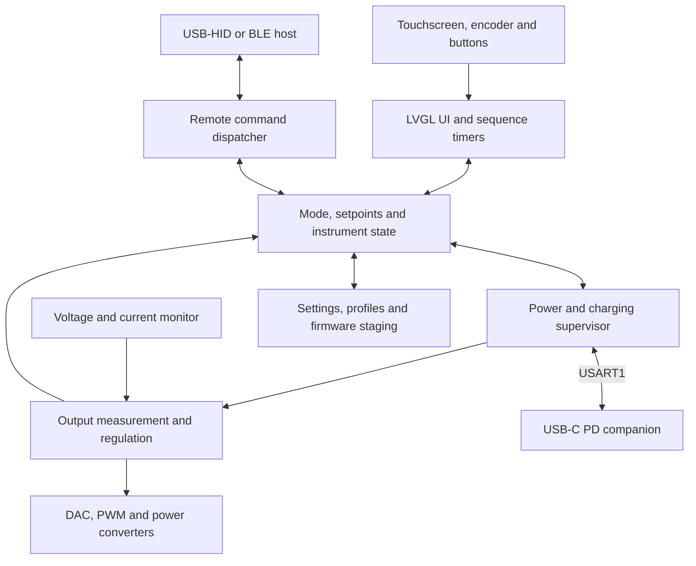

# MP305B firmware architecture

The MP305B 1.6.0.51 main application is a FreeRTOS power instrument built around
an HC32F4A0 Cortex-M4F. The same output control hardware serves four modes:
regulated DC, programmable DC, USB-C PD source testing, and battery charging.
The touchscreen and remote protocol request changes; the power controller applies
them according to the selected mode and active protections.

This document describes static analysis of the MP305B **1.6.0.51** ARM application.
The [wire protocol](PROTOCOL.md) describes the host interface and records separate
hardware observations on **1.6.0.46**. The architecture and limits below were
derived from the binary and were not all exercised on hardware.

## Runtime and hardware

During reset, `SystemInit` sets the vector table base to `0x00010000`. Application
startup initializes the clocks, pin and peripheral drivers, power state, and watchdog,
then starts FreeRTOS. A temporary `Start_Task` creates the four application tasks
and deletes itself. The kernel tick is configured for 1 ms.

| Task | Priority | Responsibility |
| --- | ---: | --- |
| `Power_task` | 4 | Waits for power events, takes output measurements and adjusts the regulator. It stops and discharges the output when the state or protection flags require it. |
| `User_task` | 3 | Dispatches remote commands, transmits replies, services profile storage and feedback patterns, and handles the firmware reboot countdown. |
| `Time_task` | 2 | Runs a nominal 10 ms supervisory loop for buttons, PD peer updates, input power and operating-mode state, including charging. Slower work covers battery and output telemetry, energy accounting, fan control, and status LEDs. |
| `lvgl_task` | 0 | Runs LVGL and its timers, reads the front-panel controls, refreshes the display, and feeds the watchdog. |

The power path has two converter channels. One handles the input and internal
battery path; the other supplies the instrument output. The main MCU reads
output voltage and current from a monitor at I²C address `0x40`, corrects the
measurements, and adjusts the voltage and current controls through DAC and PWM
outputs. It also uses converter registers and GPIO to switch power paths. The
converter and monitor part numbers are unconfirmed.

The UI uses LVGL software rendering, a 320 × 240 RGB565 display driven by SPI and
DMA, and an I²C touch controller. It supports touch, encoder and button navigation,
numeric entry, charts and gauges, screen rotation and locking, English and Chinese
strings, dimming, idle shutdown, audible feedback, and status LEDs.

## Operating modes

| Mode | Capabilities present in the application |
| --- | --- |
| **Regulated DC** | Set voltage and current, enable or disable output, report CV/CC state, and select current limiting or delayed overcurrent shutdown. Supports voltage ramps, live setpoint editing, ten saved V/I presets, and elapsed time and energy counters. |
| **Programmable DC** | Load a named sequence of voltage, current, and duration steps. The runner supports jump/repeat and stop steps, start/stop, pause/resume, and previous/next step. The remote protocol can create, rename, delete, and write sequences. There are ten profile slots. |
| **USB-C PD source test** | Load one of ten source profiles, control advertised capabilities, show the selected capability and live output measurements, and inspect the attached cable. The firmware represents fixed PDOs and programmable PPS/AVS capabilities; the display uses seven or nine capability rows according to the profile. |
| **External battery charger** | Select LiHv, LiPo, Li-ion, LiFe, lead-acid, or NiMH/Cd, with chemistry-specific voltage, current, and cell-count handling. Charging uses precharge, current ramp, CC/CV, and completion or maintenance phases as applicable. It tracks capacity, energy, and time, and shows the last charge summary. |

Sequence transitions are driven by an LVGL timer with a nominal 500 ms period.
The sequence runner changes the setpoints; `Power_task` still maintains output
regulation. The timer period describes the implementation, not a measured timing
guarantee.

The main MCU exchanges PD state and configuration over USART1 with a peer. The
E-Marker panel interprets the cable information returned by that peer: cable
type, reported voltage/current/power and EPR capability, latency, and data-rate
class. Thunderbolt and USB4 labels describe reported cable capabilities, not a
throughput measurement.

The external charger limits requested current to 5 A and, for nonzero measured
pack voltage, bounds current by `150000000 / measured_mV` in milliamps. That is a
150 W algorithmic ceiling before thermal derating and other limits, not a
guarantee of delivered power. The nickel charging path includes pulsed
voltage-drop termination.

## Supervision, control, and storage

- **Internal battery:** The input power path supervises charging of the built-in
  battery separately from external charger mode. It estimates state of charge
  using battery voltage and accumulated current and tracks charge limits, cycle
  information, power, and remaining-time estimates.
- **Protection and cooling:** The code tracks reverse output voltage, low internal
  battery, battery/board temperature, overcurrent, overvoltage, voltage deviation,
  converter initialization faults, and charger battery disconnect or abnormal
  voltage. Faults can inhibit or stop output. Fan control uses thermal thresholds
  with hysteresis and supply-voltage compensation.
- **Remote control:** USB-HID and BLE expose telemetry, settings, mode and output
  control, charge configuration, PD profiles, cable information, and sequences.
  The ARM application dispatches framed commands received over USART3 and
  implements remote ownership, permission dialogs, Bluetooth binding confirmation,
  and accessory-list UI. The WebLink screen directs users to the remote client;
  no HTTP or TCP/IP stack was identified in the main application.
- **Persistence:** Internal flash holds a checksummed system settings journal.
  External SPI flash holds PD and sequence profiles, with checksum validation and
  regeneration of defaults, and also stages firmware updates.
- **Updates and service:** The main application handles staging erase, block writes,
  verification by checksum, update markers, and a reboot handoff. It also has a
  power-path self-test, factory reset, hidden current calibration and diagnostics,
  and a USART7 ASCII console with setpoint, temperature-test, fan, and language
  controls. These are firmware paths, not evidence that the driver has verified
  them on a device.

## Analysis anchors

These are Thumb instruction addresses in the 476,160-byte 1.6.0.51 ARM image
loaded at `0x00010000`. The routine names are descriptive analysis labels except
for the task name strings stored in the image.

| Area | Addresses |
| --- | --- |
| Startup and task creation | `0x533c0` application `main`; `0x1d7a0` task creation; `0x6579c` SysTick setup |
| Application tasks | `0x1b494` power; `0x1f208` user; `0x1e020` time; `0x53338` LVGL |
| Regulation and protection | `0x19f18` output service; `0x1978c` protection; `0x193c0` internal battery state of charge |
| Operating modes | `0x30b50` DC preset panel; `0x58d50` sequence timer; `0x33538` PD source page; `0x577c0` E-Marker display |
| External charger | `0x1f6c4` phase logic; `0x1f734` current/power limit; `0x1f8d0` nickel termination |
| Communications | `0x11900` PD peer packets; `0x12e88` USART3 receive routing; `0x12f34` command dispatch; `0x1227c` service console |
| Persistence and service | `0x1b74c` settings journal load; `0x1d380` profile storage; `0x1fe0c` staged image verification; `0x1b058` self-test |

The exact physical MCU suffix, companion chip part numbers, and bootloader
implementation remain unconfirmed. The official update also includes a separate
79,488-byte payload with 8051-style entry vectors and BLE library strings. Its
internal architecture and mapping were outside the scope of this ARM analysis.
